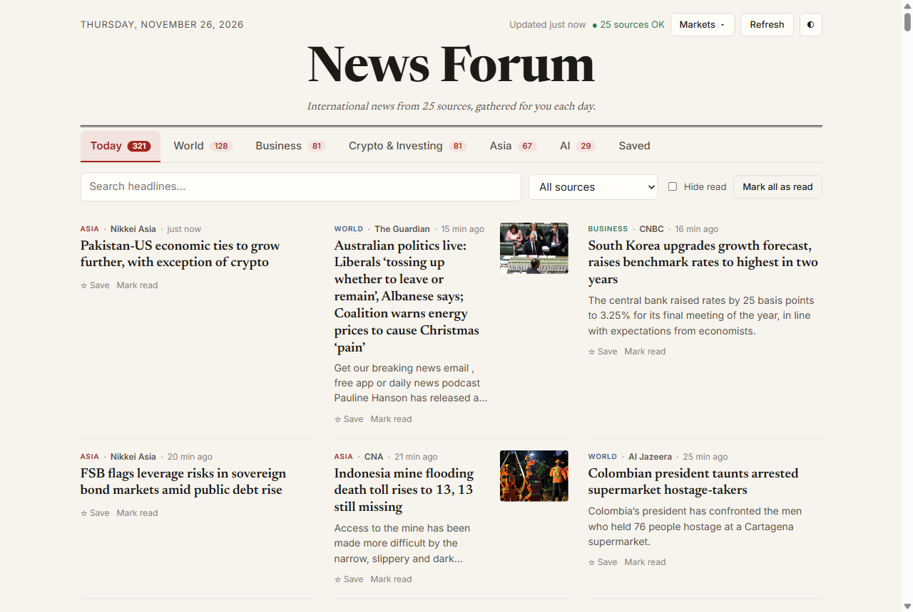
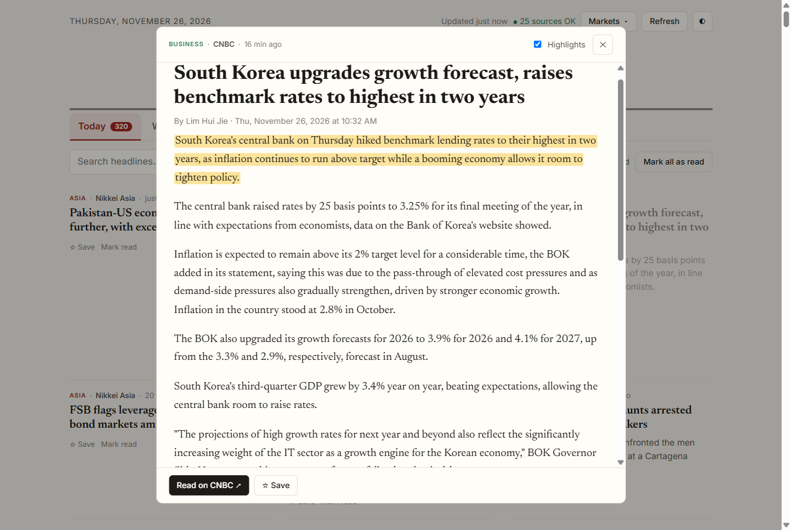
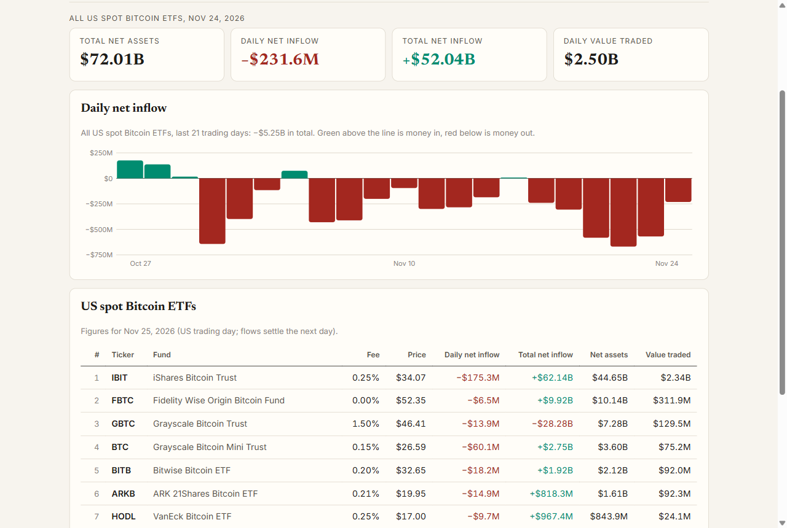
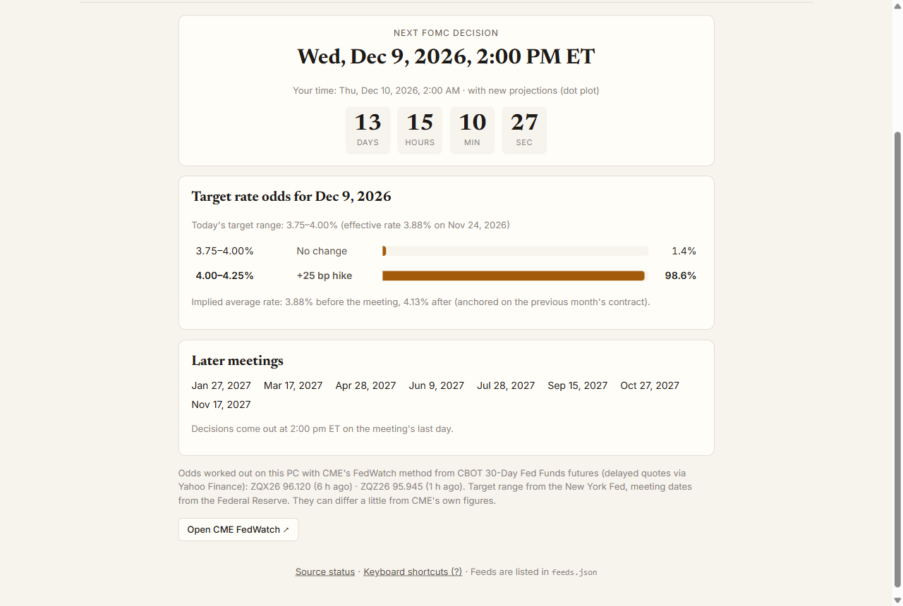
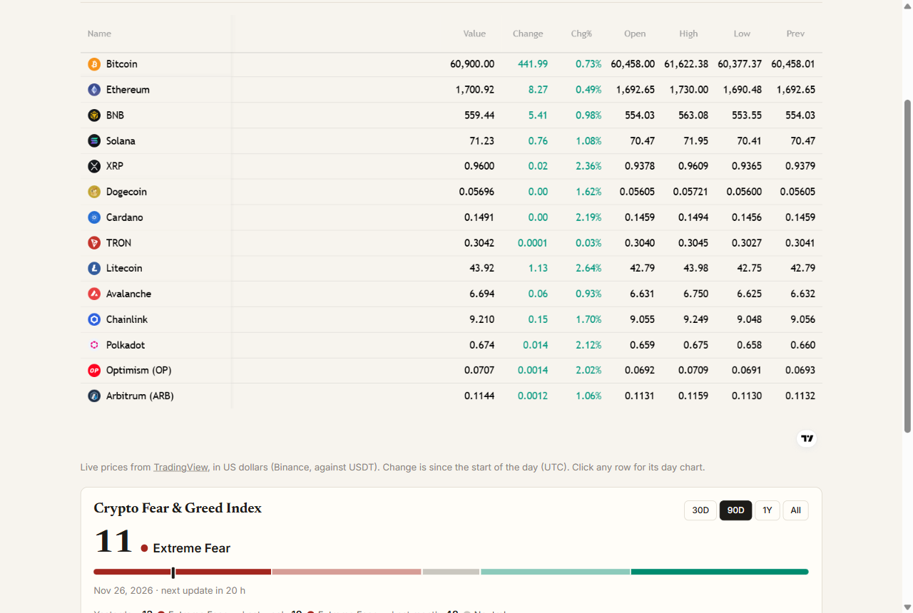
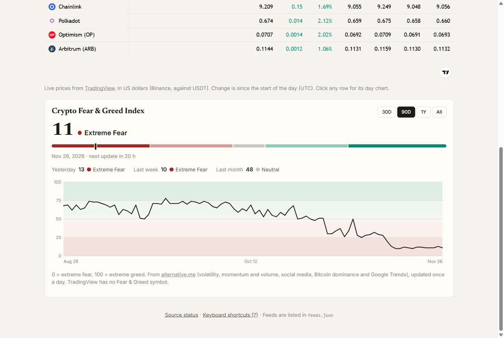
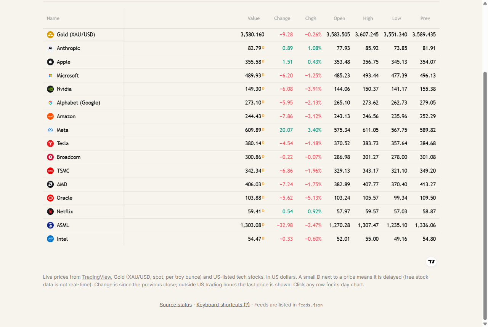
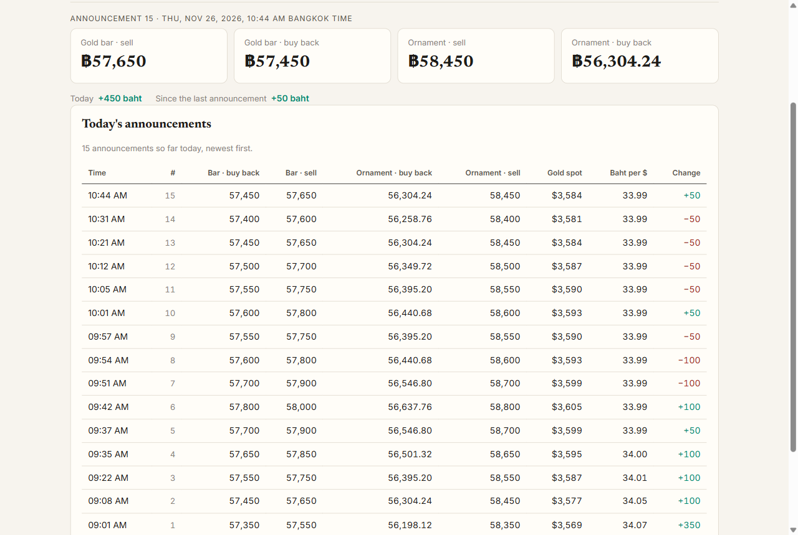
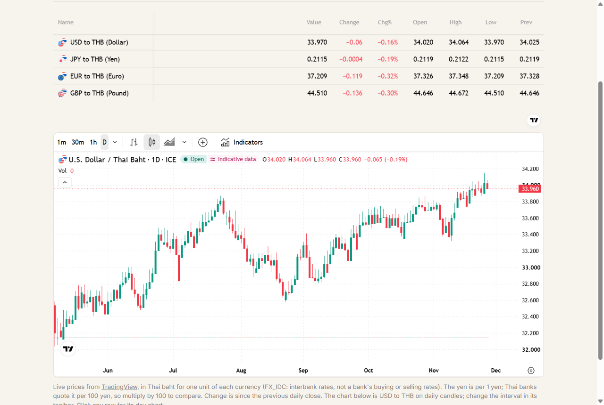

# News Forum

**25 international news feeds and a set of market pages in one quiet, newspaper-style page on your own PC.**

<p>
  
  
  
  
  
  
  
</p>

World, business, crypto and investing, Asia and AI news from public RSS feeds, with live market pages
on top. It runs only on `127.0.0.1`, keeps what you have read and saved in a local SQLite file, and
needs no account or paid service.

<p align="center">
  
</p>

## What it does

- **One list, no duplicates.** Every source in one page with tabs; a story carried by two feeds shows once.
- **Remembers you.** Read stories fade, each tab shows its unread count, and starred stories stay in **Saved**.
- **Stays short.** Only today's and yesterday's stories are kept; it fetches again every 2 hours while open.
- **Reader pop-up.** Click a card for the whole story without ads or banners, with its 1–3 key sentences
  highlighted (picked on your PC, no AI).
- **A broken feed doesn't break the page.** "25 sources OK" at the top, or which ones are down and why.
- **Keyboard-friendly.** `←` `→` sections, `j` `k` stories, `Enter` open, `s` save, `/` search, `?` for all.

| Tab | Sources |
|---|---|
| **Today** | Everything from the last 24 hours, newest first |
| **World** | BBC World · Al Jazeera · DW · The Guardian · NPR · France 24 |
| **Business** | BBC Business · CNBC · Guardian Business |
| **Crypto & Investing** | CoinDesk · Cointelegraph · Decrypt · CNBC Markets · CNBC Investing · Guardian Money |
| **Asia** | CNA · Nikkei Asia · Bangkok Post · The Diplomat · BBC Asia |
| **AI** | The Verge AI · The Decoder · MIT Tech Review AI · Guardian AI · Wired AI |
| **Saved** | Stories you starred |

## Market pages (Markets ▾, top right)

| Page | What it shows | Data from |
|---|---|---|
| **BTC ETF** | US spot Bitcoin ETFs: flows, net assets and prices, with a daily net-inflow chart | SoSoValue (free key) |
| **FedWatch** | Countdown to the next Fed rate decision and the market's odds for each outcome | Fed, NY Fed, CBOT futures |
| **Crypto Prices** | 14 coins, plus the Crypto Fear & Greed Index and its history | TradingView, alternative.me |
| **Stock Prices** | Gold (XAU/USD) and 15 US tech stocks | TradingView |
| **Gold TH Price** | Thai gold bar and ornament prices and every announcement today | ทองคำราคา.com |
| **Currency to THB** | USD, JPY, EUR and GBP to Thai baht, with a USD to THB chart | TradingView |

Click any TradingView price row for its day chart. More in [MARKET-PAGES.md](docs/MARKET-PAGES.md).

## Screenshots

| | |
|---|---|
| <br><sub><b>Reader pop-up</b> with a highlighted key sentence</sub> | <br><sub><b>BTC ETF</b></sub> |
| <br><sub><b>FedWatch</b></sub> | <br><sub><b>Crypto Prices</b></sub> |
| <br><sub><b>Fear &amp; Greed Index</b> (on Crypto Prices)</sub> | <br><sub><b>Stock Prices</b></sub> |
| <br><sub><b>Gold TH Price</b></sub> | <br><sub><b>Currency to THB</b></sub> |

## Running it

```bat
py -3.13 -m pip install -r requirements.txt
"Start News Forum.bat"
```

This opens <http://127.0.0.1:8770>. To start it at Windows login without a window, and for the
optional settings in `.env` (the BTC ETF key, Telegram price messages), see the
[developer guide](docs/DEVELOPER-GUIDE.md#1-setup). To add or remove a news source, edit
[`feeds.json`](feeds.json) and restart.

> **Needs internet** for the feeds and market data. **No login:** it listens only on `127.0.0.1`, so
> other devices can't reach it.

## Documentation

- [Developer guide](docs/DEVELOPER-GUIDE.md): setup, how it works, settings, API, tests, file tree
- [Market pages](docs/MARKET-PAGES.md): how each market page gets and shows its data
- [Diagram Flow](docs/Diagram%20Flow.md): pictures of how the parts connect
- [Running on a home PC](docs/Running-On-Home.md): setting it up on another computer
- [Changelog](docs/CHANGELOG.md): what changed, and when
